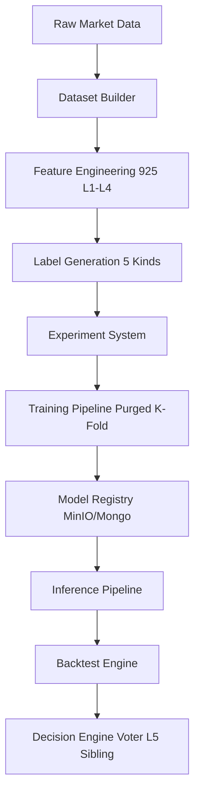

# Atlas Learning System: Architecture and Implementation

## 1. Executive Summary

The Atlas Learning System is a production-grade, distributed quantitative research framework designed to manage the entire machine learning lifecycle for financial market representations. Atlas is **not** a trading bot, **not** a basic Technical Analysis library, and **not** a simple ML wrapper. It is a mathematically pure, two-tier financial market representation framework. 

Built on a robust distributed architecture leveraging Celery and Redis for distributed computation, MongoDB for metadata storage, and MinIO for artifact management, Atlas handles end-to-end quantitative pipelines. This document details the Learning System which implements the full ML lifecycle: `Dataset -> Experiment -> Train -> Register -> Infer -> Backtest`.

---

## 2. The L5 Sibling Architecture

A core design tenet of Atlas is the strict decoupling of the Learning System from the core Decision Engine.

### 2.1 Decoupling and Purity
The Decision Engine operates on a foundation of 22 deterministic signal extractors that feed into a regime-conditional weighted voter system. In contrast, the Learning System constitutes the **L5 Sibling Architecture**. It acts as a parallel, isolated module that consumes features and outputs predictions, but never directly mutates the state or logic of the Decision Engine.

- **Why this matters:** Hedge funds and institutional trading desks require explainability. By isolating non-deterministic or statistically approximate machine learning models (L5) from deterministic logic (Decision Engine), we prevent catastrophic failures caused by concept drift from affecting core baseline trading systems.

### 2.2 Feature Hierarchy
The system operates on an expansive universe of **925 features** strictly organized across 4 layers of derivation (and 1,039 total features across the platform):
- **Layer 1 (L1 - 612 features):** Base transformations, normalized returns, rolling statistics, microstructural ticks, order flow imbalance.
- **Layer 2 (L2 - 151 features):** Cross-asset moments, basic statistical arbitrage bases, multi-timeframe aggregations, fractal relationships.
- **Layer 3 (L3 - 90 features):** Regime classification embeddings, macro-economic state proxies, volatility surface mappings.
- **Layer 4 (L4 - 72 features):** Complex structural embeddings, deep order-book imbalance vectors, liquidity cascading metrics.

---

## 3. The Machine Learning Lifecycle

The Learning System orchestration traverses six distinct phases:

### Phase 1: Dataset Builder
The Dataset Builder is responsible for manifesting training matrices from raw data:
1. **Providers:** Connects to specific Exchange APIs or historical Parquet data lakes.
2. **OHLCV Fetching:** Retrieves base price and volume data at the specified temporal resolution.
3. **Feature Computation:** Sequentially derives L1 through L4 features via `atlas_core.compute`.
4. **NaN Policy:** Drops or forward-fills NaNs based on a strict `dropna_policy`. For time-series, future leakage is prevented by strict row-wise localized filling.
5. **Label Generation:** Maps future price action to target variables (detailed below).

### Phase 2: Experiment System
Experiments are defined via declarative hyperparameter configs:
- Defines model type, Walk-forward splits, feature subsets, and labeling strategies.
- Tracked immutably in MongoDB to prevent "p-hacking" and overfit delusion.

### Phase 3: Training Pipeline & Data Splitting
Implements the training loop:
- **Purged K-Fold with Embargo:** Standard K-Fold cross-validation leaks information in autocorrelated financial time series. Atlas implements Purged K-Fold. We "purge" observations from the training set that occur inside the evaluation period, and add an "embargo" period after the test set to prevent leakage from the test set's label look-forward window.
- **Walk-forward Analysis:** Utilizes expanding or rolling window sizes to simulate production deployment and capture non-stationary market regimes.

### Phase 4: Model Registry
- **MongoDB:** Stores metadata (metrics, parameters, feature lists).
- **MinIO:** Stores serialized `.pkl` or `.pt` artifacts.
- **Versioning:** Semantic versioning tied to experiment hashes.

### Phase 5: Inference Pipeline
Saved models generate live signals. The inference pipeline deserializes the MinIO artifact, reconstitutes the exact feature pipeline, and outputs calibrated probabilities.

### Phase 6: Backtest
Integrates with the Atlas Backtest Engine (detailed in `BACKTEST_ENGINE.md`).

---

## 4. Label Generation Mathematics

The Learning System supports 5 deterministic label kinds:

### 4.1 Sign Label (`sign`)
The simplest objective, predicting the direction of the forward return:
$$ L_{t} = \text{sgn}(\ln(P_{t+h}) - \ln(P_t)) $$
Where $h$ is the prediction horizon in bars.

### 4.2 Quantile Label (`quantile`)
A cross-sectional or rolling classification that drops the middle third to focus the model on high-conviction moves:
$$ L_t = \begin{cases} 1 & \text{if } R_{t,t+h} > q_{67} \\ -1 & \text{if } R_{t,t+h} < q_{33} \\ \text{NaN} & \text{otherwise} \end{cases} $$

### 4.3 Volatility Normalized Return (`vol_norm`)
Scales the forward return by the prevailing Average True Range (ATR) to normalize across volatility regimes:
$$ L_t = \frac{\ln(P_{t+h}) - \ln(P_t)}{\text{ATR}_w(t) \cdot \sqrt{h}} $$

### 4.4 Triple Barrier Method (`triple_barrier`)
Based on Marcos López de Prado's standard. A path-dependent label that records which barrier is hit first:
- **Upper Barrier (Take Profit):** $P_t(1 + pt)$
- **Lower Barrier (Stop Loss):** $P_t(1 - sl)$
- **Time Barrier:** $t + h$
$L_t \in \{-1, 0, 1\}$ depending on whether the lower, time, or upper barrier is touched first.

### 4.5 Regime-Conditional Triple Barrier (`regime_triple_barrier`)
An Atlas-specific innovation that dynamically expands or contracts barrier widths based on the active L3 Regime embedding:
- **Dynamic Multiplier:** $M_t = f(\text{L3\_Regime}_t)$
- **Upper Barrier:** $P_t(1 + pt \cdot \sigma_t \cdot M_t)$
- **Lower Barrier:** $P_t(1 - sl \cdot \sigma_t \cdot M_t)$
This ensures the model isn't penalized for stop-outs during known high-volatility structural transitions.

---

## 5. Supported Model Architectures

The system integrates 7 distinct model kinds, spanning linear combinations to deep sequence models:

### 5.1 Traditional Machine Learning
1. **LogisticRegression:** Baseline L1/L2 penalized linear model. Highly interpretable, used for feature selection and regime-conditional biases.
2. **RandomForest:** Non-linear tree ensemble. Provides robust baseline feature importance through mean decrease impurity.
3. **GradientBoosting:** Sequential tree builder for smaller datasets.
4. **XGBoost:** Highly optimized, distributed gradient boosting. The primary workhorse for tabular L1/L2 features.

### 5.2 Deep Sequence Models (Neural)
5. **LSTM (Long Short-Term Memory):** Recurrent network optimized for path-dependent feature embeddings. Captures temporal autocorrelation inherently missing in tree models.
6. **Transformer:** Attention-based architecture. Used exclusively on L4 features (order book imbalances) to compute cross-asset attention heads.
7. **TFT (Temporal Fusion Transformer):** State-of-the-art interpretable time-series model. Used to isolate static covariates from dynamic temporal features.

---

## 6. Private Research Modules

Atlas is partitioned to support 5 private research modules, which utilize the Learning System for alpha generation:
1. **Stat Arb:** Statistical Arbitrage bases and cointegration divergence.
2. **Whale Hunter:** Order flow toxicity and block-trade detection.
3. **Funding Arb:** Perpetual futures funding rate mean-reversion.
4. **Futures:** Basis and term-structure momentum.
5. **Options:** Volatility surface relative-value trading.

---

## 7. Feature Registry & Selection

Features are registered immutably. Feature selection is performed via:
- Spearman Rank Information Coefficient (IC).
- Mutual Information (MI) against the 5 label kinds.
- Cluster-based Feature Selection (CFI) to reduce multicollinearity among features, ensuring models are not overwhelmed by highly correlated L1 variations.

---

## 8. Conclusion and Extensibility

The Atlas Learning System is constructed to institutional standards. By strictly segregating the L5 Machine Learning infrastructure from the deterministic core Decision Engine, Atlas ensures mathematical purity, exact reproducibility via the MinIO/MongoDB registry, and leakage-free walk-forward validation via Purged K-Fold architectures.

### System Diagram & Flow

